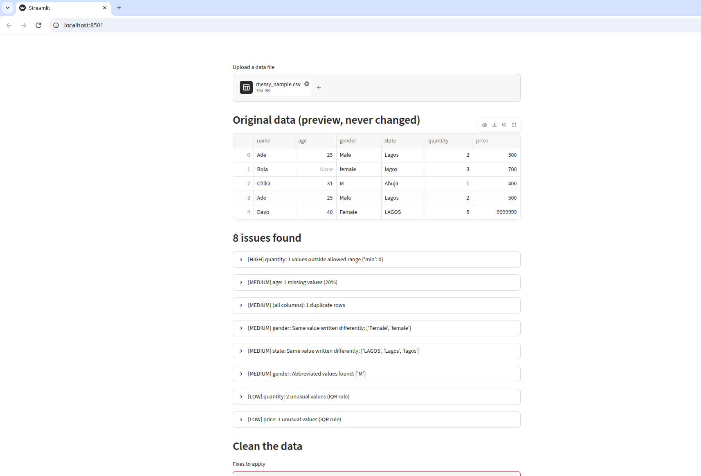
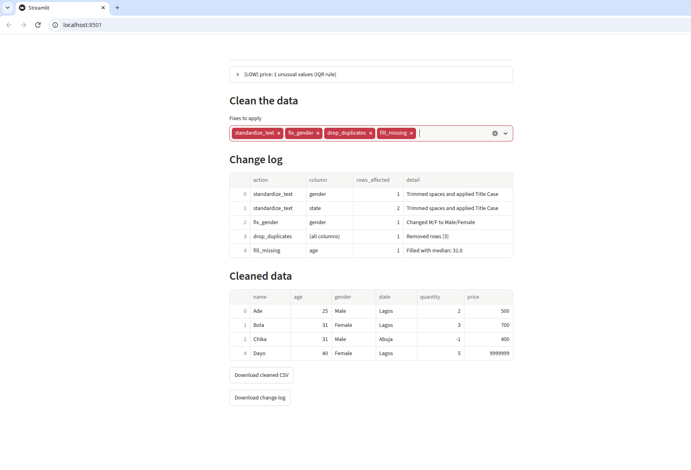

# Data Quality Checker 🔍

A web app that scans a spreadsheet for data problems, explains them, and produces a cleaned file with a full log of every change. Built as part of my journey into data analysis and Python engineering, by building real tools that solve real problems.

## 🧠 Why This Project Matters

Messy data (blank values, duplicate rows, inconsistent spellings) leads to wrong analysis and bad decisions, and cleaning it by hand is slow. I built this tool step by step: plan the checks → write each one → run it on a deliberately messy file → read the error when it broke → fix it → add a test. I used Claude as a coding guide along the way, and I wrote tests so every check is proven to work.

## 📌 What It Does

* Accepts CSV, TSV, Excel and JSON files
* Detects missing values, duplicate rows and inconsistent spellings (Lagos / lagos / LAGOS)
* Detects abbreviated gender values (M / F) and invalid values (e.g. a negative quantity)
* Flags outliers using the IQR rule
* Ranks every issue by severity (high / medium / low) and shows the affected rows
* Applies the fixes you choose, on a copy, so your original data is never changed
* Lets you download the cleaned CSV and a change log of everything that was done

## 📸 Screenshots

Issues detected in a messy sample file:



Cleaned data with a full change log:



## 🛠️ Built With

* Python
* Pandas for data checking and cleaning
* Streamlit for the web interface
* Pytest for automated tests

## 🚀 How to Run

1. Make sure you have Python 3 installed
2. Clone or download this repository
3. In your terminal, run:

```
pip install -r requirements.txt
streamlit run app.py
```

4. Upload a data file and review the issues
5. Choose the fixes to apply, then download the cleaned file and change log

To run the tests:

```
python3 -m pytest -q
```

## 📂 Project Structure

```
data-quality-checker/
├── app.py              # Streamlit interface
├── dq/
│   ├── checks.py       # Detects each type of data problem
│   ├── cleaner.py      # Applies fixes and records the change log
│   └── report.py       # Runs all checks and ranks issues by severity
├── data/
│   └── messy_sample.csv  # Sample file with planted errors
├── tests/
│   └── test_checks.py  # Automated tests
├── requirements.txt
└── README.md
```

## 📋 Example

Input (messy data):

```
name,age,gender,state,quantity,price
Ade,25,Male,Lagos,2,500
Bola,,female,lagos,3,700
Chika,31,M,Abuja,-1,400
Ade,25,Male,Lagos,2,500
Dayo,40,Female,LAGOS,5,9999999
```

Change log produced:

```
standardize_text  gender  1  Trimmed spaces and applied Title Case
standardize_text  state   2  Trimmed spaces and applied Title Case
fix_gender        gender  1  Changed M/F to Male/Female
drop_duplicates   (all)   1  Removed rows [3]
fill_missing      age     1  Filled with median: 31.0
```

## 🎯 Design Decisions

* The original data is never modified; cleaning works on a copy
* Every change is recorded in a change log
* Invalid values (like a negative quantity) are flagged but not auto-corrected, because the tool cannot know the right value
* One failing check never crashes the app; it is reported as a warning

## ⚠️ Known Limitations

* Title Case can wrongly alter emails or IDs (McDonald becomes Mcdonald)
* Outlier detection uses a simple IQR rule and is unreliable on tiny datasets
* Missing values are filled with the median or most common value, a rough default
* Tabular files only (no PDF or Word), up to 200,000 rows

## 🌱 Future Improvements

* Let users set their own validation rules in the app
* Detect numbers stored as text
* Detect rows where total ≠ quantity × price
* Support more category and naming variants

## 👩🏾‍💻 Author

Zainab Toyin: Learning Python and data analysis, one project at a time
[LinkedIn](https://www.linkedin.com/in/zainabtoyin)